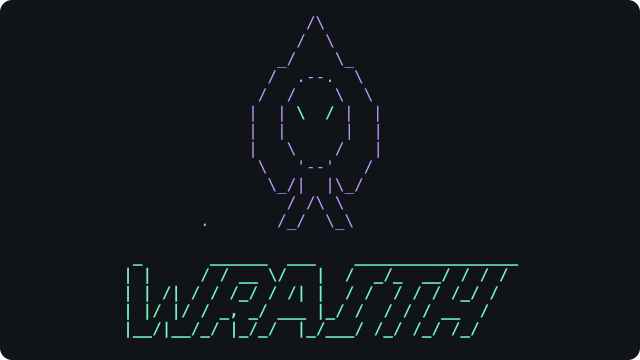
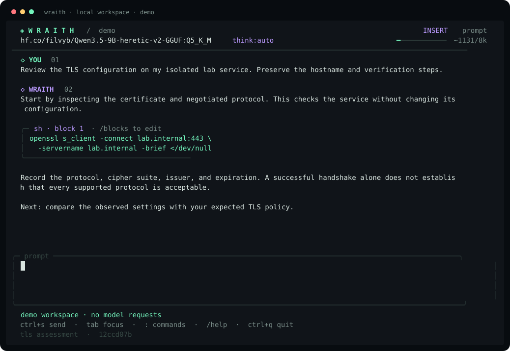

<div align="center">



**vim keys. your models. real shells.**

a terminal workspace for cybersecurity research, code review and lab work.

[usage](docs/usage.md) · [configuration](docs/configuration.md) · [providers](docs/providers.md) · [context](docs/context.md) · [private variables](docs/private-variables.md)

</div>



*demo workspace · linux · go · neovim by default*

## start

with go 1.27+, ollama, neovim and zsh installed:

```sh
make install
ollama pull hf.co/filvyb/Qwen3.5-9B-heretic-v2-GGUF:Q5_K_M
wraith
```

add `~/.local/bin` to `PATH`. wraith starts ollama on a refused local connection and preloads your selected model. `/models` lists installed models and loads your selection immediately. the shared server stays running when wraith exits.

configure the editor, shell and providers in `~/.config/wraith/config.yaml`. `wraith --demo` opens a sample workspace without connecting to a model.

## one workspace

| feature | behavior |
| --- | --- |
| modal prompts | insert, normal and visual modes, counts, operators, search, undo and clipboard yanks |
| conversation cursor | navigate replies, highlight search matches, select prose and copy complete command blocks |
| message editing | edit assistant text externally; fork a user message back into the prompt after confirmation |
| command completion | type `/`, filter with your query, use arrows and enter; `/settings.` reveals categories |
| command approval | review the command and its reason, run, edit, reject, or ask for a revision inline |
| output history | compressed records of approved commands, exit status and output, with a vim reader |
| output control | agent runs share bounded evidence; hide output per job, or use blocks mode for manual sharing |
| background jobs | approve tracked background work, inspect live output, cancel jobs and receive completion evidence |
| targeted output reads | model polls, searches and pages authorized output without filling context |
| private variables | directory/global annotated bindings, green local substitution and provider redaction |
| real terminals | centered `alt+e` scratch shell and independent `alt+s` side shell with configurable sizes |
| terminal copy mode | triple escape exposes a cursor, visual selection, clipboard yanks and `/` search |
| context management | persistent instructions, exact pins, automatic or prompted compaction and original archives |
| model backends | ollama, openai-compatible APIs, anthropic, deepseek, codex cli and claude cli |
| reasoning | supported thinking controls, streamed reasoning and expandable thinking sections |
| saved sessions | directory-scoped resume picker, compressed storage, recovery and markdown export |
| appearance | ten built-in themes, custom palettes, themed cursors and an animated hooded Wraith emblem and ASCII wordmark |

## stay on the keyboard

| binding | action |
| --- | --- |
| `ctrl+s`, normal-mode `:w` | send the draft |
| `enter` | newline in the prompt; choose a completion or popup item |
| `esc`, `i`, `v`, `V` | normal, insert and visual modes |
| `ctrl+e` | open the focused draft or message in your editor |
| `tab` | switch prompt/conversation focus |
| `h j k l`, `w b e`, `{ }`, `^ $`, `gg G` | move the cursor |
| `10j`, `100k`, `ye`, `yf,`, `df(`, `Y` | counted motions, operators and line yanks |
| `/`, `n`, `N` | search the focused prompt or conversation and repeat matches |
| up/down in insert mode | recall prompts and slash commands; restore your unsent draft |
| `[` / `]`, `za` | select messages; expand or collapse thinking |
| `<leader>j`, `/jobs` | inspect current-session jobs and live output |
| `ctrl+x` in job output | cancel a tracked job |
| `<leader>b` | open blocks; default leader is space, with hints and configurable sequences |
| `alt+e`, `alt+s` | toggle scratch and side shells |
| `ctrl+\` | leave live shell focus |
| triple escape inside a shell | enter terminal copy mode; `i` returns to live input |
| `ctrl+g` in output | share evidence when that job is private |
| `q` in normal mode, `ctrl+q` | save and exit |

pickers support arrows, `j/k` and `/` filtering. settings are grouped into categories; `?` explains the selected option. this modal editor implements the documented motions and operators; the external editor supplies full Neovim features. [complete keys and commands →](docs/usage.md)

## commands you control

the model distinguishes suggested code from a request to execute a concrete command. execution requests show the command and its **reason**, without exposing the internal protocol. placeholder targets remain suggestions. select run once to authorize execution, edit and save to run once, reject and stop the turn, or request a revision. an empty revision prompt prepares a `modify:` draft for your next message.

normal code blocks remain available through `/blocks` or enter on their command rows. saving a shell block stages its actual command in a terminal; enter inserts it into the shell input, and the next enter executes it. other languages use a saved file and interpreter. blocks mode keeps execution proposals and approvals while making output sharing optional.

`/jobs` shows current-session jobs; `/history` opens saved command records. agent mode returns the approved command, status and bounded output automatically, then continues. choose **run · hide output from agent** to withhold that job’s output. blocks mode shares only on request unless `execution.auto_share` is enabled. raw scratch-shell output can be shared from copy mode; automatic terminal sharing captures changed snapshots before the next request. it does not infer command boundaries in an interactive shell. [approval and output details →](docs/execution.md)

background requests show their mode in approval. the agent receives a start receipt, can poll or search authorized output, and receives completion evidence at a safe point without replacing your draft. configurable concurrency, timeouts, capture sizes and per-turn budgets bound the work.

shells preserve their cwd, jobs and scrollback while hidden. exiting restarts the shell, with a restart limit for repeatedly failing configurations. the side pane ends above the footer. inherited backgrounds expose the host terminal's background; font, actual alpha and blur are host-terminal settings. [terminal configuration →](docs/terminals.md)

## keep target values local

```text
/env edit
/env set TARGET_DOMAIN=lab.example
/env global edit
```

bindings belong to the launch directory unless you confirm global scope. attach `#`, `//` or `/* */` comments to explain each name; the model receives names and comments, not values. it writes `wraith::TARGET_DOMAIN`, which Wraith resolves locally and highlights in green. approved shells receive literal values; provider-bound conversation and shared output use redacted markers. invalid references trigger up to three visible streaming retries. exact-value redaction has limits for arbitrary encodings and partial selections; [variable syntax and privacy details](docs/private-variables.md) explain the boundary.

## keep the context that matters

```text
/remember prefer concise answers with reproducible verification steps
/pin scope: the isolated lab service at lab.internal:443
/context
/compact
```

`/instructions` edits preferences shared by all chats. `/pins` supports editing and removing individual facts. pins stay verbatim. compaction retains recent turns, extracts older facts in bounded fragments, audits omissions and preserves the existing fact ledger. dedicated compaction instructions receive the relevant source fragment, independently of the normal chat prompt.

current sessions, archived originals and recovery caches are compressed separately. failed compaction leaves the active context unchanged. corrective retries include the failed result and validation error, with up to three retries. exact archives are lossless; model summaries cannot guarantee every semantic detail. pin critical facts and use `/archives` when exact wording matters.

by default, wraith asks at 90% estimated context usage. declining postpones the question until the next qualifying response; the third decline compacts automatically. select `auto` or `manual` to change this policy. any positive integer is accepted for context capacity; your provider and hardware determine what can actually run. [compaction and recovery →](docs/context.md)

## your models and appearance

```text
/providers
/provider openai
/model MODEL_ID
/think
/settings.appearance
/theme rose-pine
/set editor ["nvim"]
/set shell ["zsh", "-i"]
/set context 32768
/set compact.mode auto
```

API profiles support base URLs, environment or inline keys, headers, model lists, thinking modes and custom chat instructions. CLI profiles launch codex or claude as isolated child processes and stream their replies; they do not attach to an existing interactive CLI session. Codex discovers its native model catalog for `/models`, including supported thinking levels. context capacity follows the selected provider and model; edit it through `/settings.context` or `/set context`, and use `/set context auto` to restore its default. configured model catalogs support backends without discovery. [setup and provider limits →](docs/providers.md)

choose **phosphor**, **tokyo**, **ember**, **ice**, **mono**, **rose-pine**, **dracula**, **everforest**, **nord** or **catppuccin-mocha**, or define a palette in YAML. background inheritance, animations, pane dimensions, leader sequences and global bindings are configurable. [themes](docs/themes.md) · [complete configuration](docs/config.example.yaml)

## chats and diagnostics

```sh
wraith a prompt to prepare
wraith --resume
wraith --resume SESSION_ID
wraith --provider openai --model MODEL_ID
wraith sessions
wraith doctor
wraith export SESSION_ID > chat.md
```

plain `wraith` opens a fresh conversation. `--resume` and `/resume` open the same searchable picker, restricted to the current directory. supplying an id resumes directly; an invalid or different-directory id shows an error and starts a new conversation. `/clear` starts fresh while preserving the old session. `/export`, `/archives`, `/restore`, `/retry` and `/cancel` cover recovery.

storage is private to your user and configurable through directory flags. compression is not encryption. the cybersecurity prompt asks for evidence, precise scope, reproducible checks and explicit uncertainty; execution remains a user decision.

## build and verify

```sh
make build
make check
```

checks cover race detection, private-value boundaries, shell quoting, concurrent jobs, output pagination, recovery journals, provider streams, cancellation, corrective compaction, compressed recovery, real ptys, editor handoff, command approval, output sharing, search and modal editing. tests use local fixtures without a model or GPU. fuzz targets exercise terminal parsing and prompt edits.

[ci](.github/workflows/ci.yml) runs on every push to main and on pull requests, verifies modules, fuzzes parsers and cross-builds linux amd64/arm64. [tagged releases](.github/workflows/release.yml) run checks before creating checksummed draft packages. [architecture](docs/architecture.md) · [development](docs/development.md)

## freedom

wraith is free software under the [GNU GPL, version 3 or later](LICENSE). see [NOTICE](NOTICE) for the project copyright and grant.
