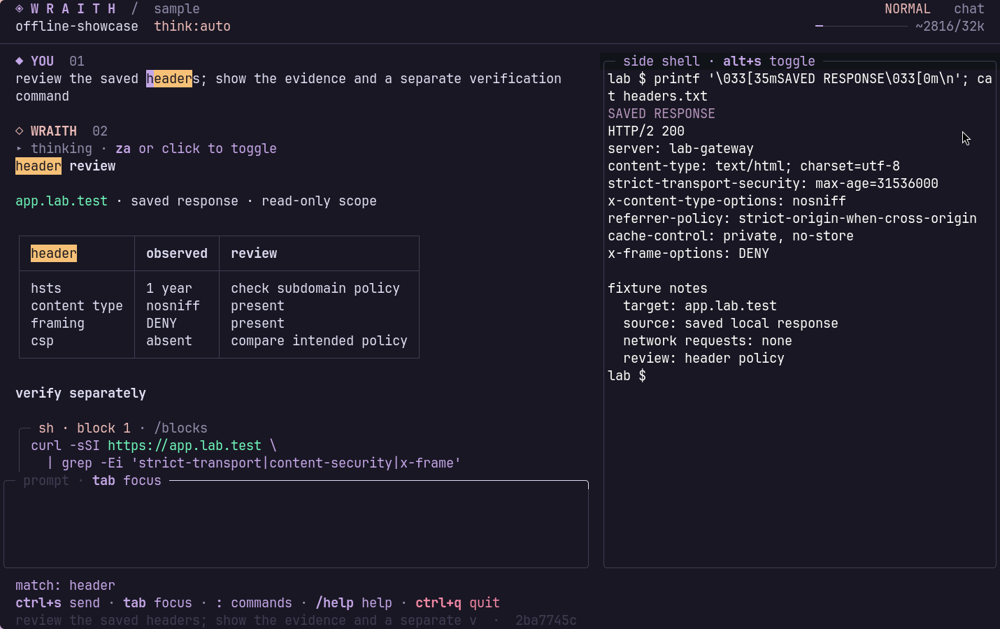
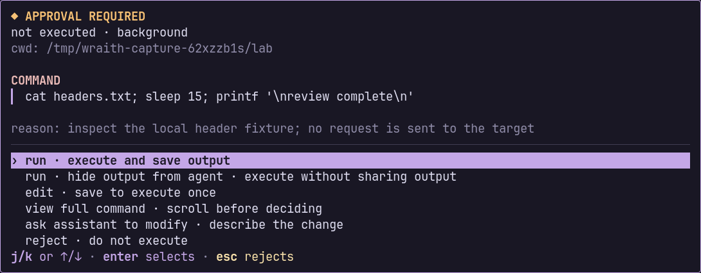
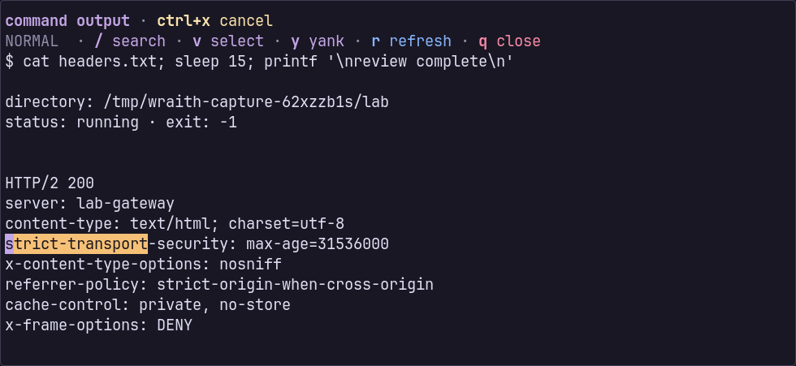
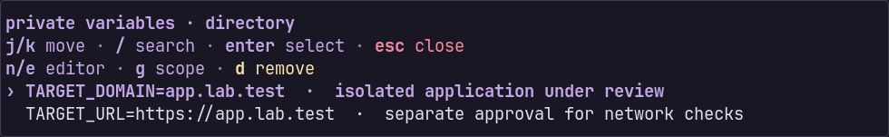

<div align="center">


# wraith

**your models. vim keys. commands you approve.**

a terminal workspace for cybersecurity research, code review and lab work.

[install](docs/getting-started.md) · [docs](docs/README.md) · [configuration](docs/configuration.md) · [screenshots](docs/screenshots.md)

</div>



*actual app in ghostty, using isolated sample content and a local header file. [full-size capture](docs/assets/screenshots/workspace.png) · [workflow gallery](docs/screenshots.md) · [all ten themes](docs/screenshots.md#themes).*

## install

linux, go 1.27+, and a model backend. defaults use ollama, neovim, zsh and `wl-copy`; each is configurable.

```sh
git clone https://github.com/erdajt/wraith.git
cd wraith
make install
export PATH="$HOME/.local/bin:$PATH"
ollama pull hf.co/filvyb/Qwen3.5-9B-heretic-v2-GGUF:Q5_K_M
wraith
```

already have a model? use `wraith --model MODEL_ID` or `/models`. wraith starts a refused local ollama connection and preloads your selected model before the first prompt. switching models loads the selection immediately. it does not download weights or force gpu offload.

for api and cli backends, configure a profile in `~/.config/wraith/config.yaml`. [setup](docs/getting-started.md) · [providers](docs/providers.md) · [troubleshooting](docs/troubleshooting.md)

## features

edit prompts with vim motions or your own editor. search and yank conversations. approve commands, then keep working while they run. keep target values local and carry the facts you need between turns.

<details>
<summary>full feature map</summary>

| area | included |
| --- | --- |
| prompts | insert, normal and visual modes; counts, motions, operators, undo, search, clipboard yanks and directory-scoped input recall |
| conversation | shared-buffer horizontal and vertical splits, independent pane navigation, themed cursor, highlighted search, visual selection, complete-command yanks, user-message forks and archived assistant edits |
| rendering | markdown headings, emphasis, tables, code blocks, streamed replies and expandable thinking |
| commands | live slash completion, dotted settings categories, searchable pickers, configurable leader sequences and action-colored key hints |
| execution | command and reason approval; run, hide output, edit, modify or reject; no second approval after selecting run |
| background work | job ids, live status/output, completion evidence, cancellation, timeouts and per-turn command/read budgets |
| output | compressed history, retained prefix and tail, bounded literal/regex searches, line windows and explicit sharing |
| private variables | conversation, directory or global scope; comments, editor management, green substitution and provider-bound redaction |
| context | per-model capacity, persistent instructions, exact pins, prompted/automatic/manual compaction, corrective retries and original archives |
| shells | centered and side panes, configurable dimensions, real ptys, persistent shell state and vim scrollback copy mode |
| providers | ollama, openai-compatible apis, anthropic, deepseek, codex cli and claude cli; configurable profiles and model catalogs |
| sessions | compressed storage, directory-scoped resume/search, interrupted-response retry, archive restore and markdown export |
| appearance | ten themes, custom palettes, inherited backgrounds, themed cursors, an animated hooded mark and reduced motion |

</details>

## work from the keyboard


| key | action |
| --- | --- |
| `ctrl+s`, normal-mode `:w` | send the draft |
| enter | newline, or choose a completion/menu item |
| escape, `i`, `v`, `V` | normal, insert and visual modes |
| `ctrl+e` | edit the focused draft or message externally |
| tab | switch prompt/conversation focus |
| `h j k l`, `w b e`, `{ }`, `^ $`, `gg G` | navigate |
| `10j`, `100k`, `ye`, `yf,`, `df(`, `Y` | counts, operators and yanks |
| `/`, `n`, `N` in normal mode | search the focused buffer and jump between highlighted matches |
| up/down in insert mode | recall input; choose slash completions when active |
| `[` / `]`, `za` | select messages; toggle thinking |
| space | leader hints; sequences are configurable |
| space `b`, space `j` | blocks or jobs |
| `alt+e`, `alt+s` | scratch shell or side shell |
| `ctrl+\`, triple escape in a shell | return focus, or enter copy mode |
| `q` in normal mode, `ctrl+q` | save and quit |

[leader hints](docs/assets/screenshots/leader.png) · [external editor](docs/assets/screenshots/editor.png) · [conversation search](docs/assets/screenshots/search.png)

pickers accept arrows, `j/k`, `/` filtering and enter. `?` explains a selected setting. visual selection copies prose precisely; touching a command block copies the entire command. yanks also fill an internal register. [all keys and remapping](docs/keybindings.md) · [slash commands](docs/usage.md#commands)

## approve once, keep working

[](docs/assets/screenshots/approval.png)

agent mode asks before executing a concrete command. choose **run**, **run with output hidden**, **edit**, **view full command**, **ask assistant to modify**, or **reject**. editing and saving authorizes that command once. an empty modification field prepares a `modify:` draft for your next prompt. unresolved placeholders remain suggestions.

ollama models that advertise tools use native function requests automatically. api profiles can enable them with `action_protocol: native`; `text` keeps the fenced protocol. both use the same approval flow. malformed requests get up to three visible corrections, while ordinary shell examples stay suggestions. [action transport](docs/providers.md#action-transport)

approved agent commands run in the background. the chat stays available. `/jobs` shows current jobs and live output; `/history` keeps saved commands, status and results. the agent receives a job id, can search or page authorized output, and gets completion evidence when the chat is ready. empty polls pause automatic calls instead of looping.

| execution mode | default output behavior |
| --- | --- |
| `agent` | approved commands run in the background and share bounded evidence |
| `blocks` | approval remains available; output shares only on request or with auto sharing enabled |
| either, explicit hide-output approval | command/status can be shared; output reads are denied until you share it |

[](docs/assets/screenshots/output.png)

[background jobs](docs/assets/screenshots/jobs.png) · [inline command revision](docs/assets/screenshots/modify.png) · [suggested blocks](docs/assets/screenshots/blocks.png)

ordinary markdown blocks never execute just by appearing. `/blocks` or enter on a command opens editing/run actions. saving a shell suggestion inserts its actual text into an empty integrated zsh input buffer; enter executes it. other shells keep explicit staging. tracked jobs use a fresh noninteractive shell. use a pane for tty programs or persistent shell state. [insertion and recovery](docs/terminals.md#saved-command-insertion)

output readers support vim motions, search, selection, copying, refresh and cancellation. large output retains a bounded prefix and recent tail; the agent gets bounded excerpts and queries. rejecting stops the requesting turn. quitting ends owned jobs and shells. [execution and recovery](docs/execution.md)

## keep values local

[](docs/assets/screenshots/variables.png)

```text
/set environment.scope directory
/env set TARGET_DOMAIN=lab.example # isolated lab service
/env edit
```

choose **conversation**, **directory** or **global** persistence. global changes warn first. comments can use `#`, `//` or `/* */` on the same line or directly above a binding. the picker renders them; the model receives names and descriptions, not raw values.

the model writes `wraith::TARGET_DOMAIN`. wraith resolves it locally, highlights it in green, and substitutes markers back into provider-bound text and shared output. shell substitution treats values as literals. invalid references trigger up to three visible corrective retries. exact-value redaction has limits for arbitrary encodings and partial values. [syntax, precedence and privacy](docs/private-variables.md)

## keep the context that matters

```text
/remember keep answers concise and include verification steps
/pin scope: the isolated lab only
/context
/set context 32768
/compact
```

`/instructions` edits preferences shared by all chats. `/pins` lets you edit or remove exact facts for this chat. capacity follows the selected provider and model; any positive integer is accepted, while native limits and available memory still apply. `/set context auto` restores automatic capacity selection.

compaction uses dedicated extraction and omission-audit requests, preserves recent turns and protected facts, and archives the original before replacement. active sessions, originals and recovery caches are compressed separately. failed candidates get up to three retries with the validation failure, then leave the original active.

by default, the app asks at 90% estimated usage. the third decline compacts automatically. choose `auto` or `manual` to change the policy. summaries cannot guarantee every semantic detail; pins preserve exact facts and `/archives` retains exact originals. [context and recovery](docs/context.md)

## two shells in the workspace


`alt+e` opens a centered scratch shell. `alt+s` opens an independent side shell above the footer. hidden panes retain their process, cwd and scrollback. `exit` restarts the pane, with a limit for repeated startup failures.

three escapes expose a stable vim cursor for scrolling, `/` search, visual selection and yanks. `i` returns to live input. `ctrl+g` shares the selected output when sharing is manual. sizes, shell, cwd, colors and scrollback are configurable. font, opacity and blur belong to the host terminal; inherited backgrounds can expose its transparency. [terminal configuration](docs/terminals.md)

## configure the workspace

```text
/settings.appearance
/theme rose-pine
/set editor ["nvim"]
/set shell ["bash", "-i"]
/set terminal.split_width 0.45
/set compact.mode auto
```

settings are grouped into model, environment, execution, context, appearance, terminals, and keys/editor. `/settings.` completes categories; `?` explains an option. edit the full yaml with `e`. invalid saved values leave the active configuration intact and retain a recovery file.

```yaml
leader: space
bindings:
  b: blocks
  j: jobs
  s a: settings.appearance
  s e: settings.execution
keys:
  send: ctrl+s
  quit: ctrl+q
  output_share: ctrl+g
```

an explicit `bindings` map replaces default leader sequences. direct action keys live under `keys`. quit hints are red, refresh blue, and cancel yellow; custom palettes can override them. [configuration reference](docs/configuration.md) · [complete default yaml](docs/config.example.yaml)

## choose your colors

the same workspace in every palette: markdown, command blocks, a private target, search highlights and a running shell. click a capture to inspect it at full size.

| rose-pine | dracula |
| --- | --- |
| [](docs/assets/screenshots/theme-rose-pine.png) | [](docs/assets/screenshots/theme-dracula.png) |

| everforest | nord |
| --- | --- |
| [](docs/assets/screenshots/theme-everforest.png) | [](docs/assets/screenshots/theme-nord.png) |

| catppuccin-mocha | phosphor |
| --- | --- |
| [](docs/assets/screenshots/theme-catppuccin-mocha.png) | [](docs/assets/screenshots/theme-phosphor.png) |

also included: **tokyo**, **ember**, **ice** and **mono**. [see all ten](docs/screenshots.md#themes).

make your own palette in `~/.config/wraith/config.yaml`:

```yaml
theme: dusk
themes:
  dusk:
    bg: '#15131d'
    fg: '#eee8f5'
    muted: '#9a8fa8'
    accent: '#c5a5ff'
    second: '#80dfce'
    border: '#42384e'
    warn: '#ffc28b'
```

custom palettes appear in `/theme`. cursor, selection, thinking, borders and search use the selected colors. `appearance.background: inherit` uses your terminal background; opacity, font and blur stay under terminal/compositor control. `animations: false` freezes the welcome mark. [theme fields and hint colors](docs/themes.md) · [terminal appearance](docs/terminals.md)

## models and sessions

```sh
wraith a prompt to prepare
wraith --resume
wraith --resume SESSION_ID
wraith --provider codex
wraith --provider openai --model MODEL_ID
wraith sessions
wraith export SESSION_ID > chat.md
wraith doctor
```

plain `wraith` opens a new conversation. positional text becomes an unsent draft. `/resume` and `--resume` open the same searchable, directory-scoped picker; an id resumes directly. invalid or different-directory ids report an error and start fresh. `/clear` retains the old chat. editing a user message forks at that point while preserving the original. [sessions, export and backups](docs/sessions.md)

`/providers` switches backends; `/models` selects an installed or configured model. `/think` changes supported native effort; `/thinking` toggles returned reasoning. profiles configure endpoints, credentials, model catalogs, per-model context, thinking and custom instructions. codex discovers its native model catalog. cli providers start isolated child processes with native tools disabled so wraith owns execution approval; they do not attach to an existing interactive session. [provider setup and limits](docs/providers.md)

## build, test and contribute

```sh
make build
make check
```

checks cover formatting, vet and race tests. suites exercise real ptys, editor handoff, privacy, approval, concurrent jobs, output queries, provider streams, compaction, recovery, search and modal editing. fixtures need no model credentials or gpu.

[ci](.github/workflows/ci.yml) runs on pushes to `main` and pull requests, fuzzes parsers and cross-builds linux amd64/arm64. [release checks](.github/workflows/release.yml) precede checksummed draft packages. [architecture](docs/architecture.md) · [development](docs/development.md) · [documentation index](docs/README.md)

## license

free software under the [gnu gpl, version 3 or later](LICENSE). copyright and grant: [NOTICE](NOTICE).
