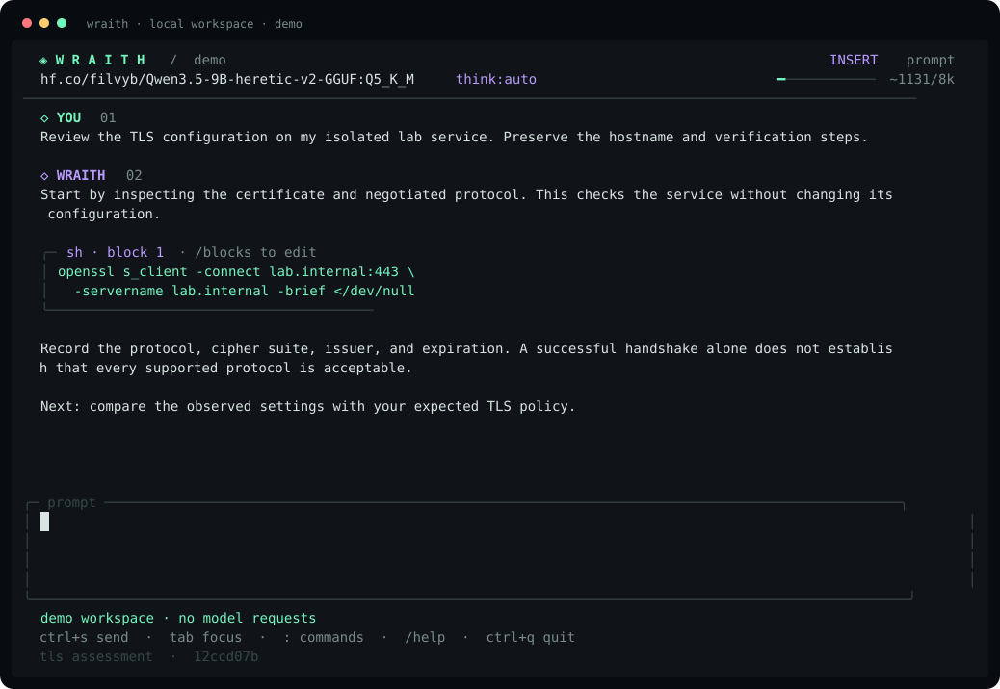

<div align="center">

# ◈ W R A I T H

**local models. vim keys. real shells.**

a terminal workspace for cybersecurity research, code review and lab work.

[getting started](docs/usage.md) · [configuration](docs/configuration.md) · [context](docs/context.md) · [development](docs/development.md)

</div>



*actual demo frame. linux · go · ollama · neovim by default.*

## start

from this checkout, with go 1.27+, ollama, neovim and zsh installed:

```sh
make install
ollama pull hf.co/filvyb/Qwen3.5-9B-heretic-v2-GGUF:Q5_K_M
wraith doctor
wraith
```

ollama must be running. add `~/.local/bin` to `PATH` if it is not already there, or run `~/.local/bin/wraith` directly. choose another shell or editor in `~/.config/wraith/config.json`. the selected qwen model is the default; `/model` and `/models` list every model you have installed in ollama.

try the interface without a model connection:

```sh
wraith --demo
```

## work in one terminal

| feature | how it works |
| --- | --- |
| modal prompts | insert, normal and visual modes; motions, operators, registers, counts, search and undo |
| transcript navigation | vim scrolling, search, message selection and direct response editing |
| external editor | `ctrl+e` opens your draft in neovim; configure any editor argument array |
| code handoff | choose `/blocks`, edit, save, then review the staged shell command |
| scratch shell | `alt+e` opens a smaller centered terminal |
| side shell | `alt+s` opens an independent terminal on the right |
| persistent panes | hide a shell without losing its cwd, variables, jobs or scrollback |
| model switching | `/model` and `/models` discover local models and refresh their capabilities |
| native thinking | `/think` exposes supported values; `/thinking` toggles returned reasoning text |
| memory | global user instructions, exact chat pins, bounded compaction and original archives |
| saved chats | compressed sessions, resume, archive recovery and markdown export |
| appearance | five themes, animated activity, configurable keys, shell colors and pane sizes |

saving code never executes it. the first `enter` inserts the staged interpreter command into the shell; the next `enter` executes the shell input. `e` edits the staged file again and `esc` dismisses it. quitting the editor without saving leaves the command unstaged.

both terminals use real linux ptys. their inherited backgrounds clear the app beneath them, allowing your host terminal's transparency to show through. fonts, opacity and blur remain host-terminal settings. [terminal behavior and configuration →](docs/terminals.md)

## keys that matter

| binding | action |
| --- | --- |
| `ctrl+s` | send the prompt |
| `enter` | newline while editing a prompt |
| `esc`, `i` | normal mode, insert mode |
| `ctrl+e` | open the draft in your configured editor |
| `tab` | switch prompt/transcript focus |
| `j k gg G ctrl+u ctrl+d` | navigate the transcript |
| `/ n N` | search the transcript and repeat matches |
| `[ ] e b` | select a message, edit a response, open code blocks |
| `:` | command mode from a normal prompt or the transcript |
| `alt+e`, `alt+s` | toggle scratch and side shells |
| `ctrl+\` | return focus from a shell to the prompt |
| `ctrl+c` | cancel model work; inside a shell it goes to the shell |
| `ctrl+q` | save and exit, closing child shells |

commands also work as `/command` in a prompt followed by `ctrl+s`. popups use `j/k`, `enter` and `esc`. global bindings are configurable; the complete default map and supported modal grammar are in [usage.md](docs/usage.md). full neovim features remain available through the external editor.

## keep the context that matters

```text
/remember prefer concise answers with reproducible verification steps
/pin scope: the isolated lab service at lab.internal:443
/context
/compact
```

`/instructions` edits preferences shared by every chat. pins stay in the active context verbatim. compaction retains recent turns, extracts older facts in bounded fragments, audits omissions, and keeps existing ledger entries. specialized extraction prompts receive the relevant source fragment instead of the entire ordinary chat prompt.

before replacement, the complete session is saved as gzip in both a recovery cache and the permanent archive directory. current sessions live separately from archives. cancelled, invalid, truncated or non-shrinking summaries leave the active context unchanged. `/archives` restores an original into a new chat; `/export` makes current context readable outside the app.

by default, a popup asks at 90% estimated context usage. declining postpones the prompt until the next qualifying response; the third decline compacts automatically. choose `auto` to compact without asking or `manual` to disable threshold prompts. oversized drafts are retained for compaction or editing before sending.

exact archives are lossless. model summaries cannot guarantee preservation of every semantic detail. pin critical facts and restore the source when exact wording matters. [the full compaction and recovery protocol →](docs/context.md)

## make it yours

```text
/settings
/theme tokyo
/set editor ["nvim"]
/set shell ["zsh", "-i"]
/set context 16384
/set predict 2048
/set compact.mode auto
/set compact.threshold 0.9
/set terminal.background inherit
```

**phosphor** brings mint and violet; **tokyo** blue and lilac; **ember** amber and rose; **ice** cyan and silver; **mono** grayscale. settings validate before they are saved. invalid editor changes remain available in a recovery file.

defaults request an 8192-token context, 2048 output tokens, six cpu inference threads and a two-minute model keep-alive. native thinking depends on the model: boolean thinking and graded effort are different capabilities. gpu placement is controlled by ollama; inspect `ollama ps` during generation before raising context. these defaults do not reserve vram or guarantee desktop responsiveness.

[complete config example](docs/config.example.json) · [settings and storage locations](docs/configuration.md)

## chats, recovery and diagnostics

```sh
wraith --new
wraith --session SESSION_ID
wraith models
wraith sessions
wraith config
wraith doctor
wraith export SESSION_ID > chat.md
```

inside the app: `/new`, `/chats`, `/resume`, `/archives`, `/restore`, `/export`, `/retry` and `/cancel` manage the workflow. `/help` lists every command. directory overrides allow isolated workspaces. one interactive writer owns each data directory; new files are private. compression is not encryption.

the cybersecurity prompt asks for evidence, precise scope, reproducible checks, explicit uncertainty, executable fences and verification steps. the model has no automatic shell tools. you decide what to edit, stage and run.

## build and verify

```sh
make build
make check
```

checks include race detection, streaming and cancellation fixtures, audited compaction, gzip recovery, real ptys, an interactive app subprocess, editor staging, terminal layouts and modal editing. fuzz targets exercise terminal parsing and prompt edits. tests do not require a model or gpu.

[ci](.github/workflows/ci.yml) runs on pushes and pull requests, fuzzes both parsers and cross-builds linux amd64/arm64. [tagged releases](.github/workflows/release.yml) run those checks before creating checksummed draft packages. hosted workflows begin once the repository is pushed.

[architecture](docs/architecture.md) · [tests, releases and contribution style](docs/development.md)
