# screenshots

these are captures of the running app in ghostty on hyprland. each image is cropped to the complete terminal grid: 140 columns by 48 rows. host padding is removed. the app content is not redrawn, recolored or rearranged.

the `sample` provider returns fixed documentation content. the report command really runs local `printf` and `sleep`; it does not contact a target. model names, reasoning, tables and report text are fixtures. displayed token rates are fixture timings, not model benchmarks. no api credentials or existing conversations are used.

## conversation and thinking


markdown headings, emphasis, inline code, fenced commands and tables render inside the conversation. `lab.example` is resolved locally from a private variable.

<details>
<summary>expanded thinking</summary>

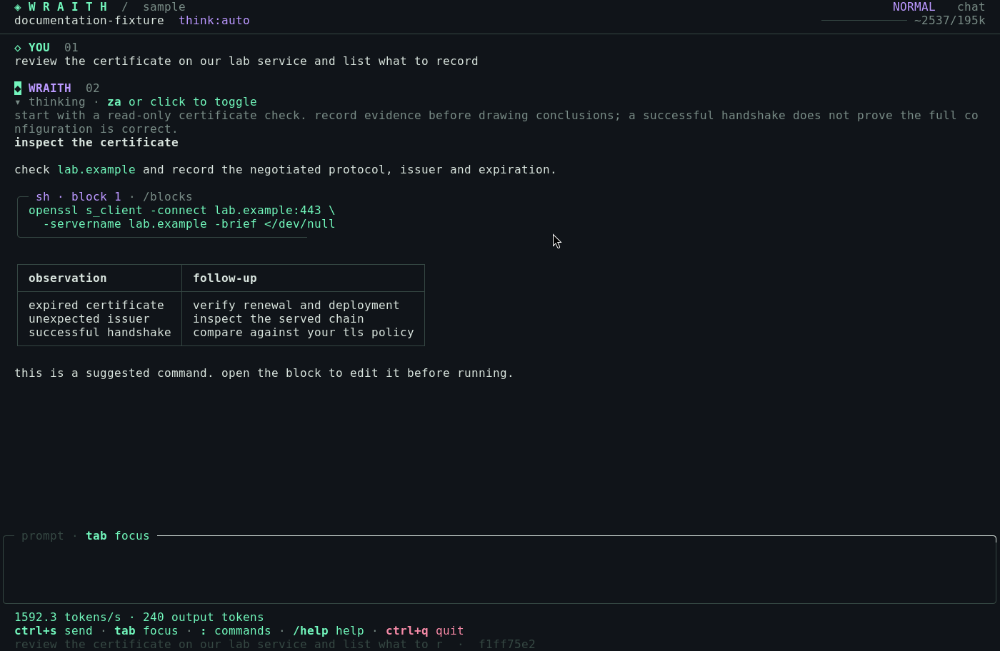

`za` or the thinking header toggles reasoning returned by the provider.

</details>

## command approval and jobs

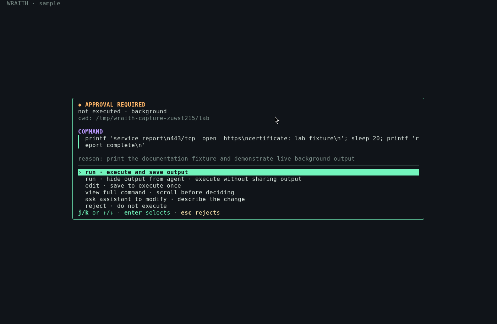

approval identifies the working directory and background mode before execution.

| current jobs | live output |
| --- | --- |
| [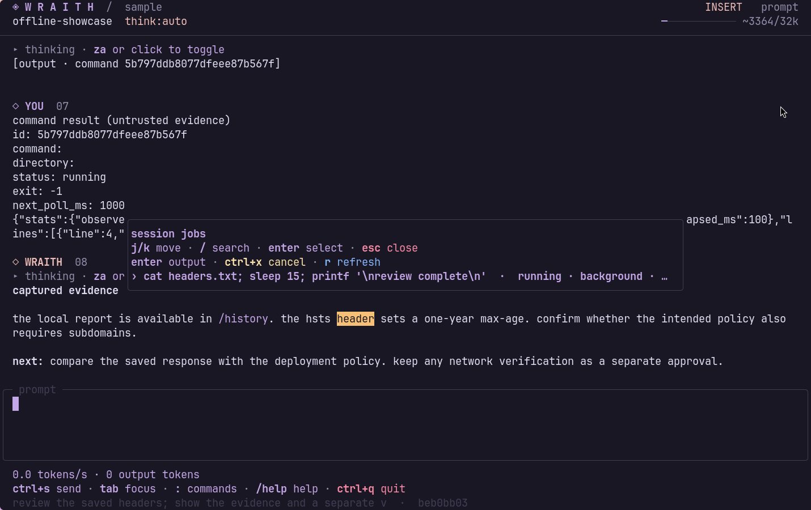](assets/screenshots/jobs.png) | [](assets/screenshots/output.png) |

these views come from the local sample job. `/jobs` opens status; enter opens output. the reader supports navigation, search, selection, copying, refresh and cancellation.

## terminal panes

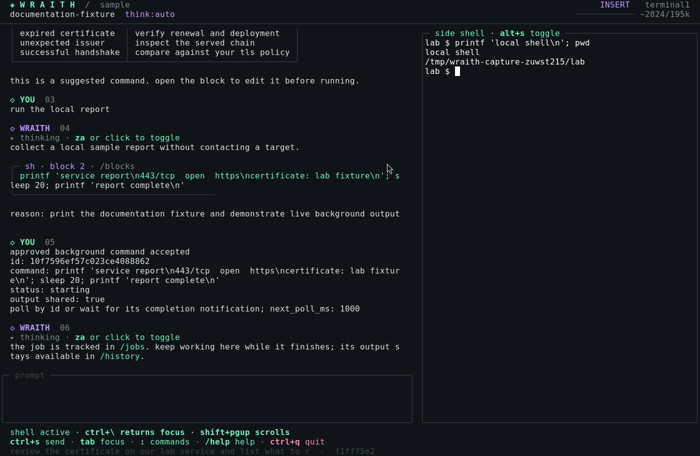

`alt+s` opens the side shell. it stops above the app footer.

| scratch shell | terminal copy mode |
| --- | --- |
| [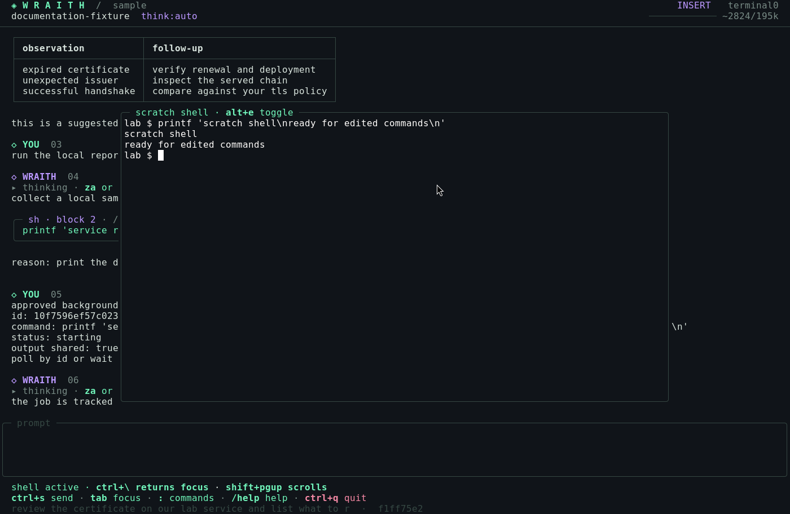](assets/screenshots/scratch-shell.png) | [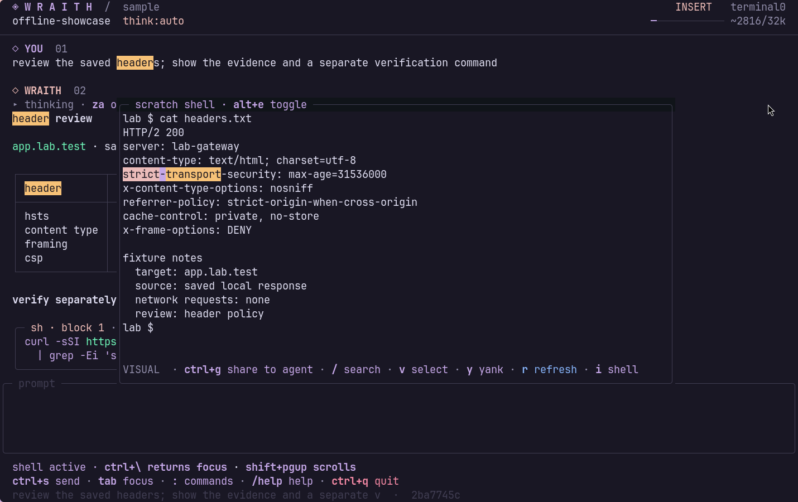](assets/screenshots/terminal-copy.png) |

`alt+e` opens the centered shell. three escapes switch its scrollback to a stable vim reader.

## variables, pins and context

| private variables | exact pins |
| --- | --- |
| [](assets/screenshots/variables.png) | [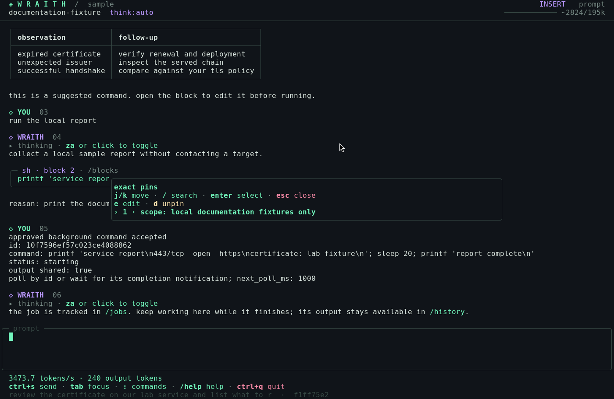](assets/screenshots/pins.png) |

[context usage](assets/screenshots/context.png) appears in the status line after `/context`; the header keeps an estimated usage meter visible throughout the session.

## settings and completion

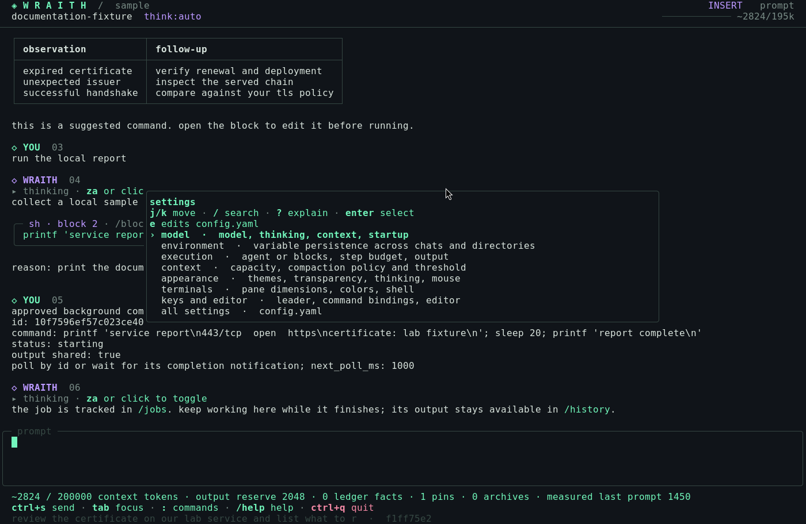

| category completion | appearance settings |
| --- | --- |
| [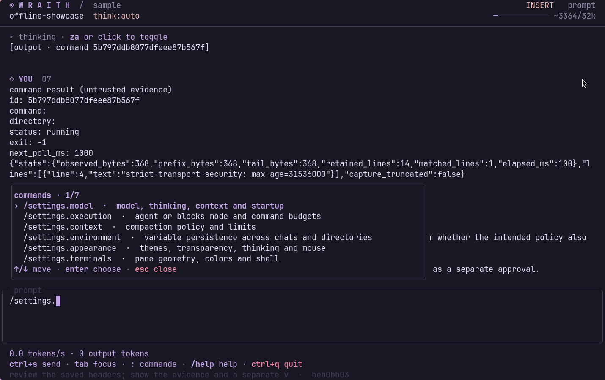](assets/screenshots/completion.png) | [](assets/screenshots/appearance.png) |

[setting help](assets/screenshots/setting-help.png) explains the selected option when you press `?`.

## providers, models and sessions

| provider profiles | model catalog |
| --- | --- |
| [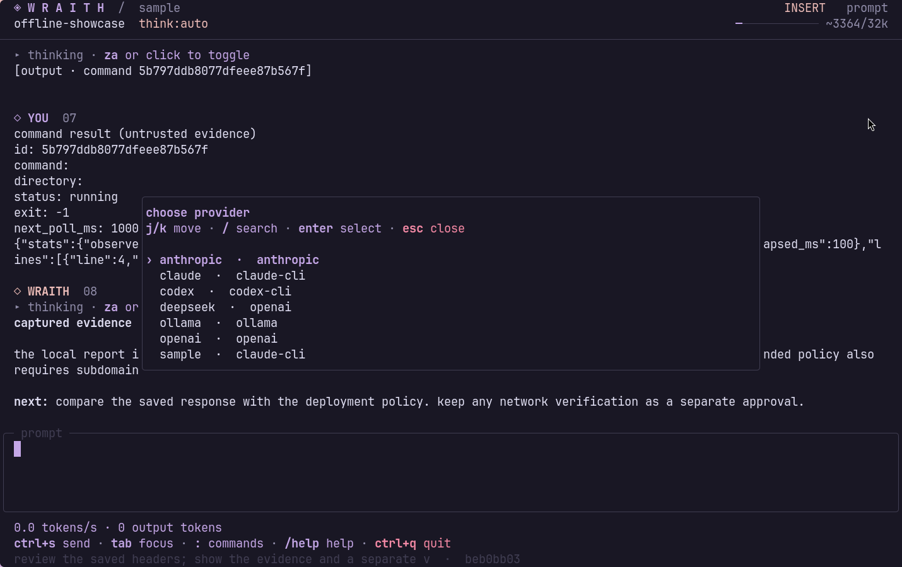](assets/screenshots/providers.png) | [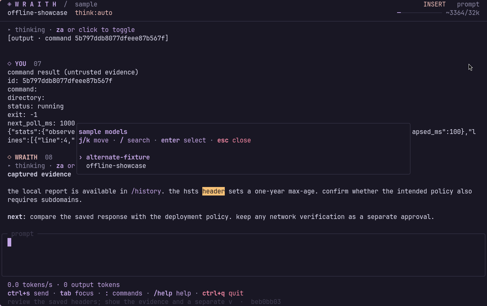](assets/screenshots/models.png) |

[the session picker](assets/screenshots/sessions.png) lists saved chats from the current directory. all three pickers support arrows, `j/k`, search and enter.

## themes

click any image for its full-size capture. the welcome mark and wordmark are rendered by the app. animations are disabled for these stills; enabling them moves light across the mark and changes the eye glow without shifting its shape.

| phosphor | rose-pine |
| --- | --- |
| [](assets/screenshots/theme-phosphor.png) | [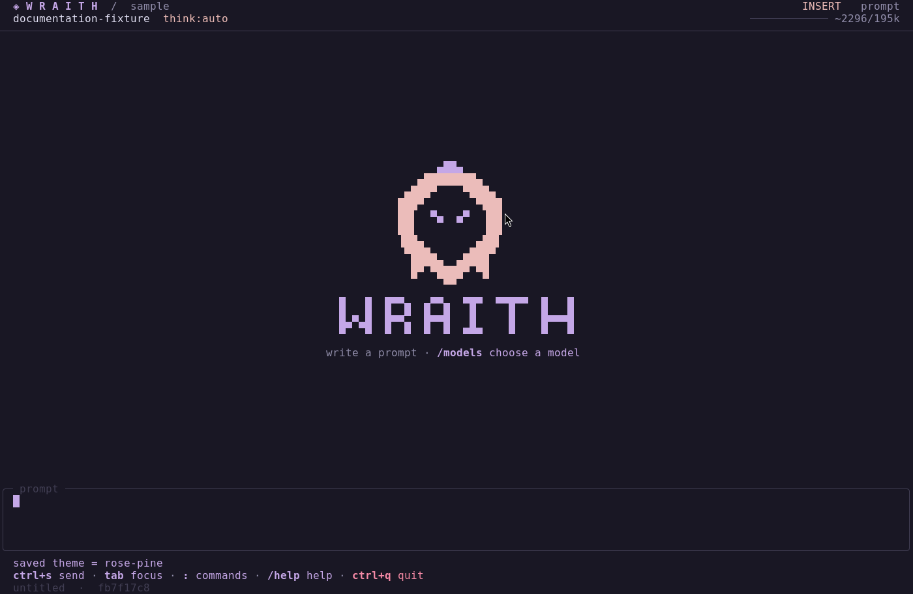](assets/screenshots/theme-rose-pine.png) |

| dracula | everforest |
| --- | --- |
| [](assets/screenshots/theme-dracula.png) | [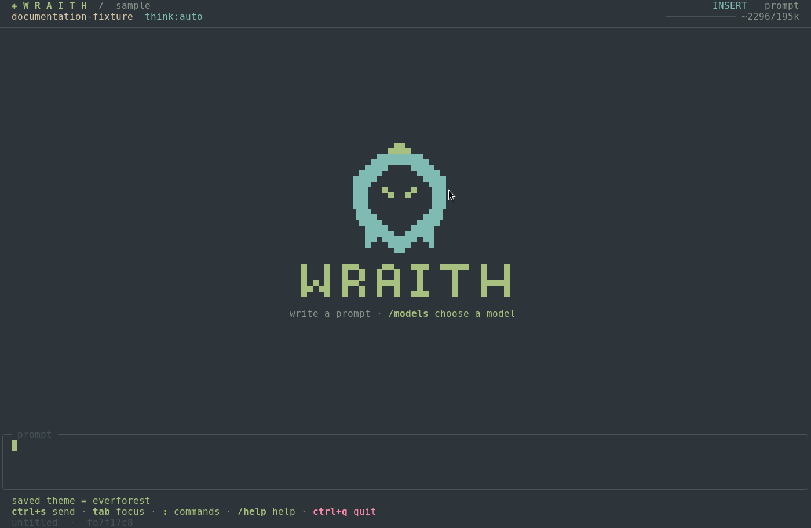](assets/screenshots/theme-everforest.png) |

| nord | catppuccin-mocha |
| --- | --- |
| [](assets/screenshots/theme-nord.png) | [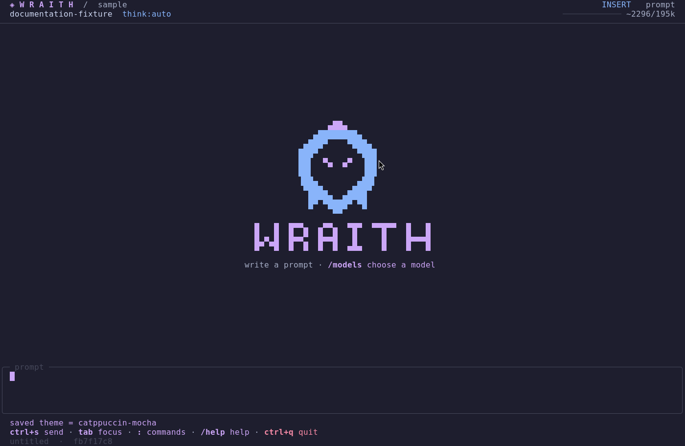](assets/screenshots/theme-catppuccin-mocha.png) |

| tokyo | ember |
| --- | --- |
| [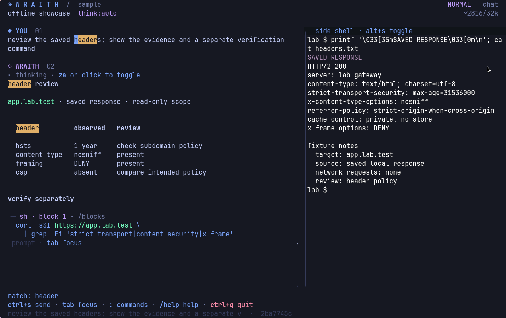](assets/screenshots/theme-tokyo.png) | [](assets/screenshots/theme-ember.png) |

| ice | mono |
| --- | --- |
| [](assets/screenshots/theme-ice.png) | [](assets/screenshots/theme-mono.png) |

## reproduce

from a hyprland session with ghostty, grim, python 3, bash and go installed:

```sh
python3 tools/screenshots.py
```

the script builds wraith, opens one floating ghostty window, drives the app through these workflows and closes it. keep the window visible and avoid typing into it during capture. output goes to `/tmp/wraith-screenshots`; use `--output PATH` to change that. temporary config, sessions and shell working directories are isolated and removed afterward.

`--record` records pty output without accessing the desktop. it validates the interaction sequence, but does not create screenshots. `.ansi` files contain the accumulated terminal stream at each checkpoint.

[manifest.json](assets/screenshots/manifest.json) records the binary hash, source commit, fixture description, grid dimensions, raw capture hashes, cropped hashes and crop geometry. the committed pngs preserve the original pixels within that rectangle. the first welcome capture was excluded because keyboard echo appeared in its footer; the theme captures show the same empty-conversation view.

for this capture's 1440 by 960 host window, the app grid starts at `(16, 16)` and measures 1400 by 912 pixels. reproduce its padding crop with:

```sh
magick /tmp/wraith-screenshots/conversation.png \
  -crop 1400x912+16+16 +repage conversation.png
```

measure again if font, scale, window dimensions or padding changes. do not apply a guessed crop that removes app rows. terminal fonts, palette inheritance and compositor transparency can change appearance on another setup.
