# screenshots

these are captures of the running app in ghostty on hyprland. full captures are cropped to the complete terminal grid: 130 columns by 36 rows. host padding is removed. panel details are tighter crops of those same captures. click a detail to open its full frame. app content is not redrawn, recolored or rearranged.

the `sample` provider returns fixed documentation content. the report command really runs local `cat`, `sleep` and `printf`; it does not contact a target. model names, reasoning, tables and report text are fixtures. the fixture reports no token usage; zero counters are not model benchmarks. no api credentials or existing conversations are used.

## workspace

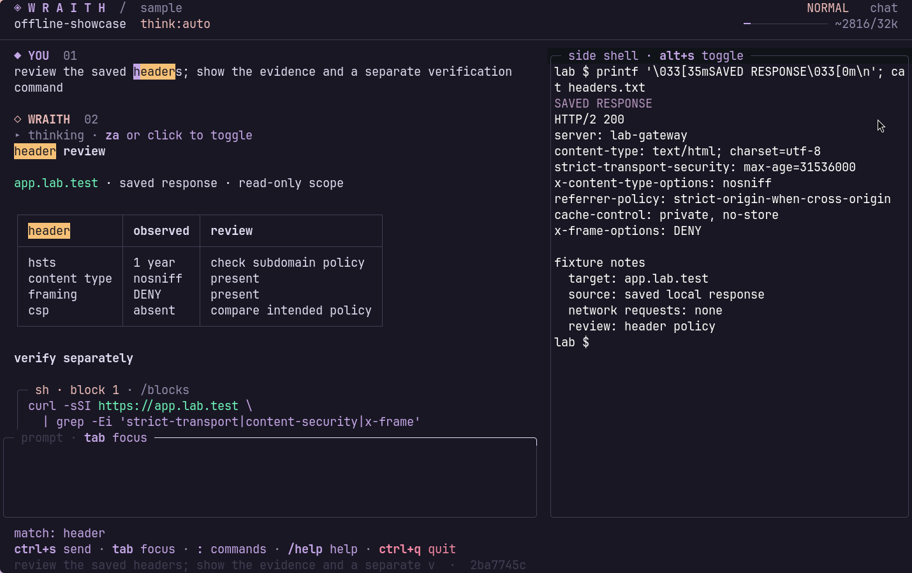

the side shell stays above the footer. the conversation shows markdown, a suggested command, locally resolved values and matching search terms.

## conversation and thinking

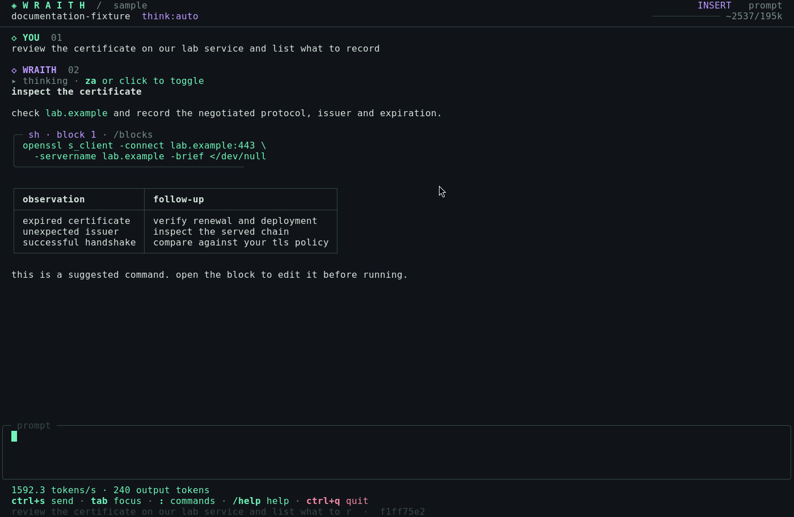

markdown headings, emphasis, inline code, fenced commands and tables render inside the conversation. `app.lab.test` is resolved locally from a private variable.

<details>
<summary>expanded thinking</summary>


`za` or the thinking header toggles reasoning returned by the provider.

</details>

## search, selection and editing

| conversation search | visual selection |
| --- | --- |
| [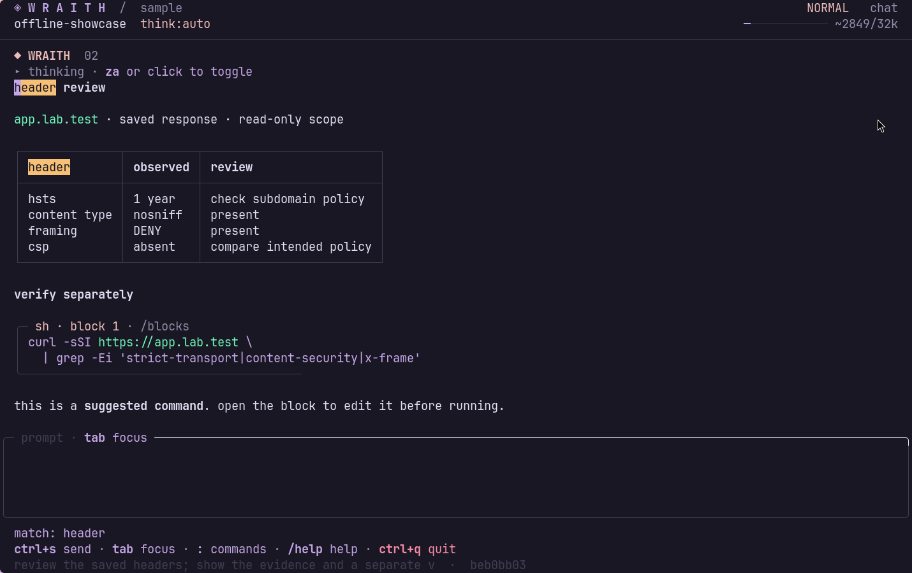](assets/screenshots/search.png) | [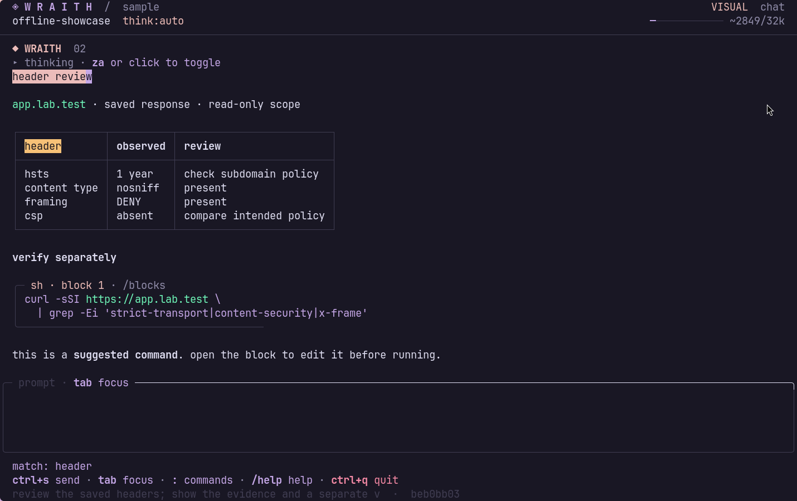](assets/screenshots/selection.png) |

normal-mode `/` searches the focused buffer. `n` and `N` move between results. `v` selects characters and `y` copies them; selecting part of a command yanks the whole command.

[leader hints](assets/screenshots/leader.png) show configured sequences. [neovim](assets/screenshots/editor.png) edits the draft through the configured editor command. [fork confirmation](assets/screenshots/fork.png) protects the original chat before editing a previous user message.

## command approval and jobs

[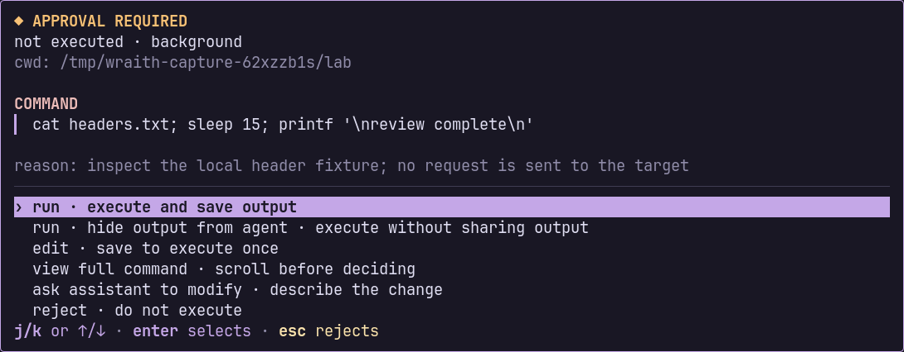](assets/screenshots/approval.png)

approval identifies the working directory and background mode before execution. [suggested blocks](assets/screenshots/blocks.png) remain separate from explicit requests.

<details>
<summary>ask the assistant to revise a command</summary>

[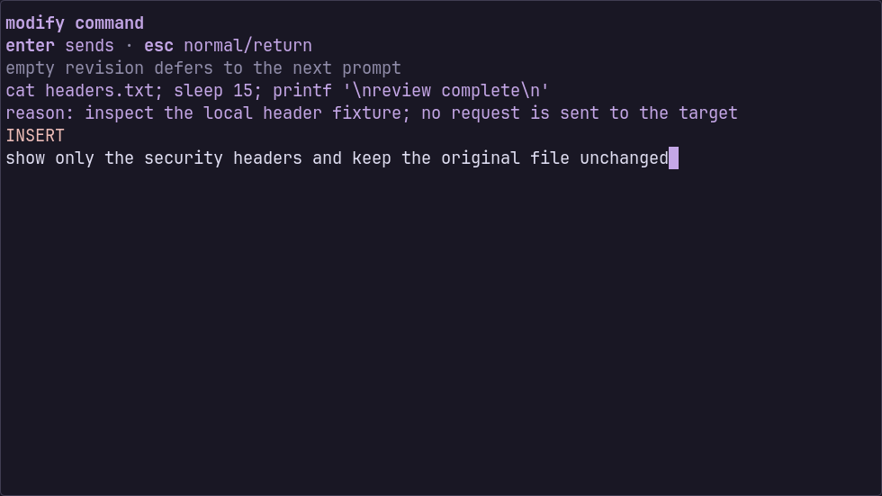](assets/screenshots/modify.png)

type a revision here or leave it empty to prepare the next prompt.

</details>

| current jobs | live output |
| --- | --- |
| [](assets/screenshots/jobs.png) | [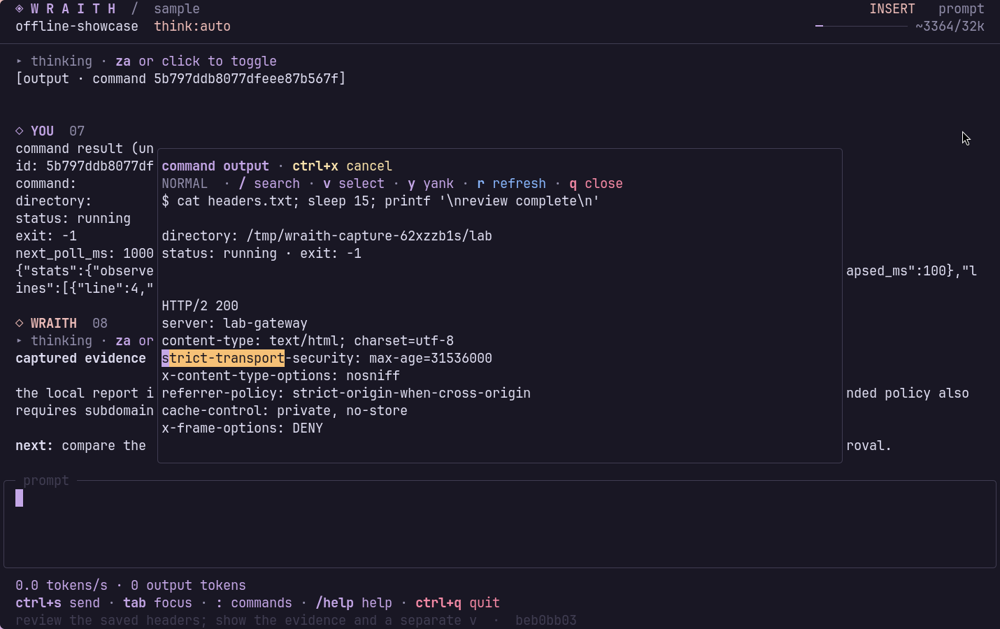](assets/screenshots/output.png) |

these views come from the local sample job. `/jobs` opens status; enter opens output. the reader supports navigation, search, selection, copying, refresh and cancellation.

## terminal panes


`alt+s` opens the side shell. it stops above the app footer.

| scratch shell | terminal copy mode |
| --- | --- |
| [](assets/screenshots/scratch-shell.png) | [](assets/screenshots/terminal-copy.png) |

`alt+e` opens the centered shell. three escapes switch its scrollback to a stable vim reader.

## variables, pins and context

| private variables | exact pins |
| --- | --- |
| [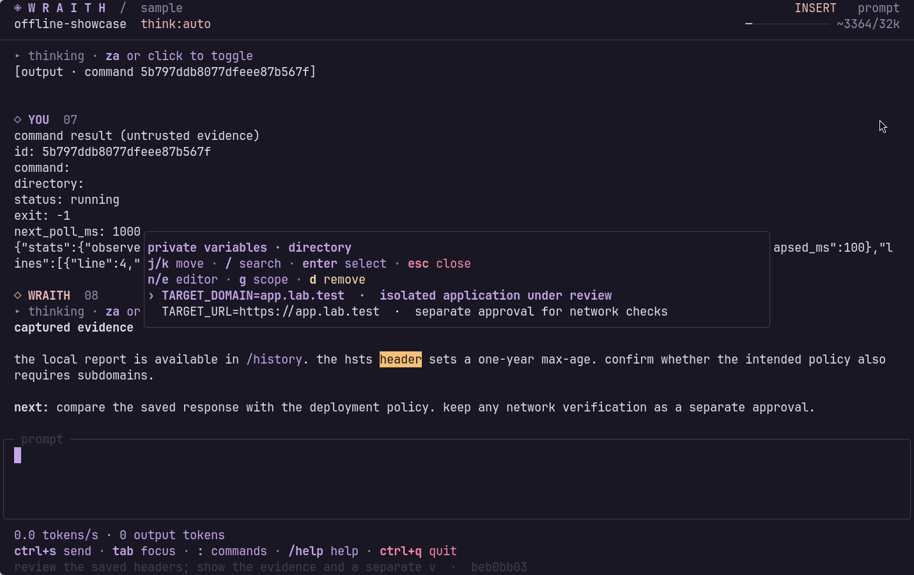](assets/screenshots/variables.png) | [](assets/screenshots/pins.png) |

[context settings](assets/screenshots/context-settings.png) cover capacity, reserves and compaction policy. [context usage](assets/screenshots/context.png) appears in the status line after `/context`; the header keeps an estimated usage meter visible throughout the session.

## settings and completion


| category completion | appearance settings |
| --- | --- |
| [](assets/screenshots/completion.png) | [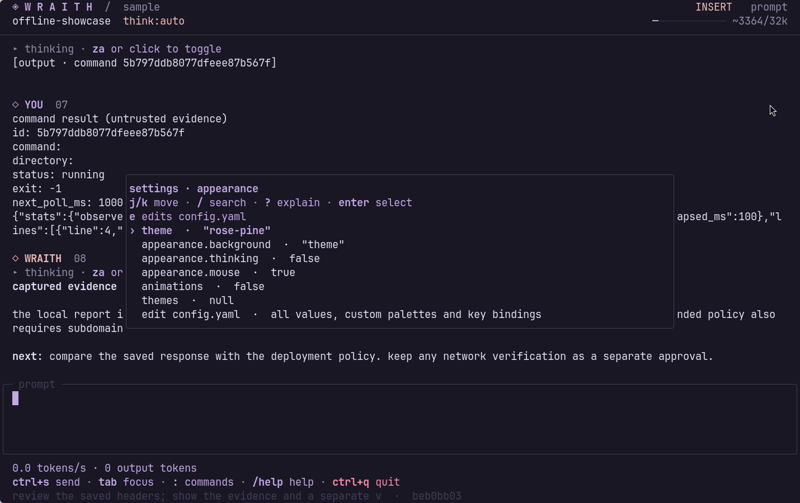](assets/screenshots/appearance.png) |

[setting help](assets/screenshots/setting-help.png) explains the selected option when you press `?`.

## providers, models and sessions

| provider profiles | model catalog |
| --- | --- |
| [](assets/screenshots/providers.png) | [](assets/screenshots/models.png) |

[the session picker](assets/screenshots/sessions.png) lists saved chats from the current directory. all three pickers support arrows, `j/k`, search and enter.

## themes

every palette shows the same populated workspace. compare the background, borders, command syntax, search highlights, cursor and key hints. click any image for its full-size capture.

the [welcome mark](assets/screenshots/welcome.png) is also rendered by the app. animations are disabled for these stills; enabling them moves light across the mark and changes the eye glow without shifting its shape. [custom palettes](themes.md) use the same rendering paths.

| phosphor | rose-pine |
| --- | --- |
| [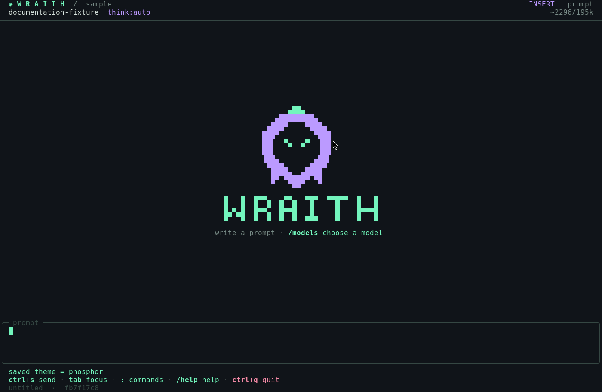](assets/screenshots/theme-phosphor.png) | [](assets/screenshots/theme-rose-pine.png) |

| dracula | everforest |
| --- | --- |
| [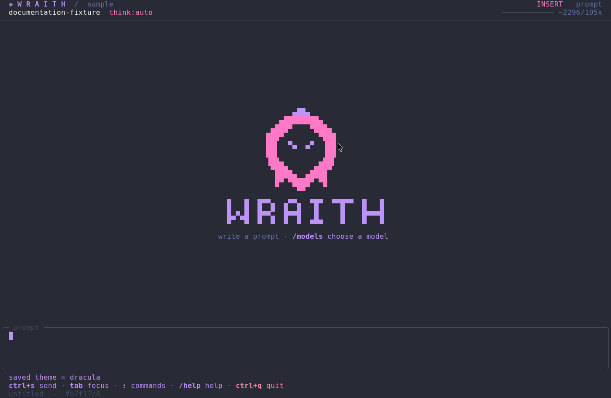](assets/screenshots/theme-dracula.png) | [](assets/screenshots/theme-everforest.png) |

| nord | catppuccin-mocha |
| --- | --- |
| [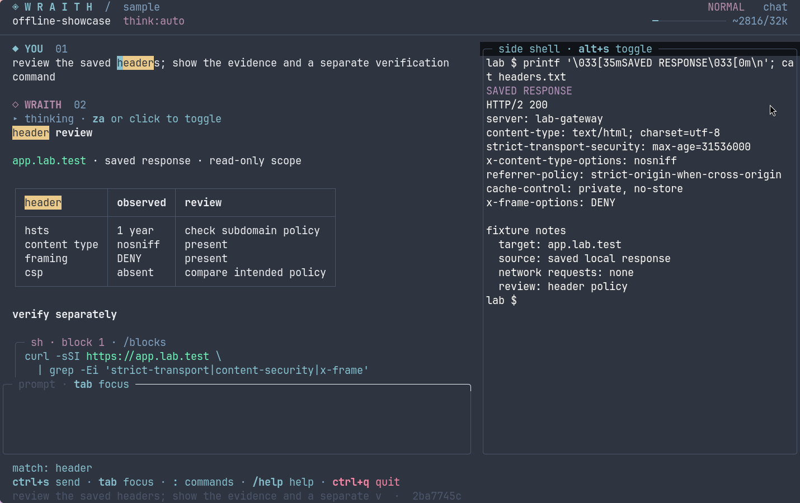](assets/screenshots/theme-nord.png) | [](assets/screenshots/theme-catppuccin-mocha.png) |

| tokyo | ember |
| --- | --- |
| [](assets/screenshots/theme-tokyo.png) | [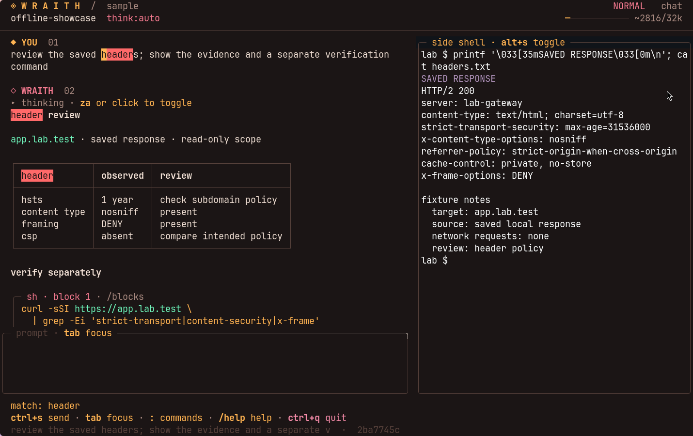](assets/screenshots/theme-ember.png) |

| ice | mono |
| --- | --- |
| [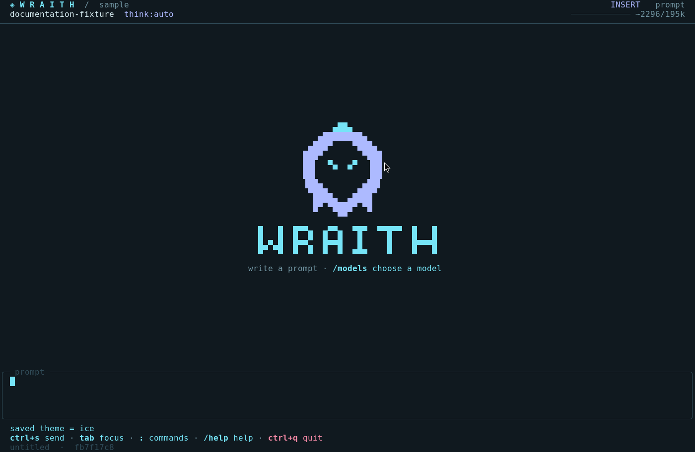](assets/screenshots/theme-ice.png) | [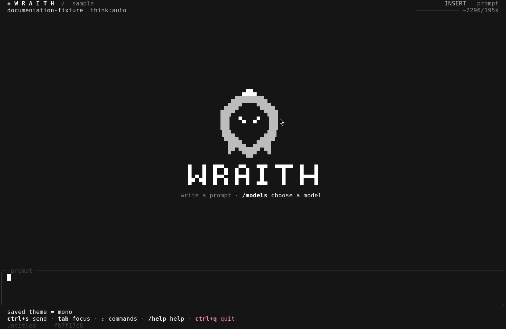](assets/screenshots/theme-mono.png) |

## reproduce

from a hyprland session with ghostty, grim, python 3, bash, neovim, go and the JetBrainsMono Nerd Font Mono font installed:

```sh
python3 tools/screenshots.py --output /tmp/wraith-showcase
```

the script builds wraith, opens one floating ghostty window, drives the app through these workflows and closes it. keep the window visible and avoid typing into it during capture. the example writes to `/tmp/wraith-showcase`; without `--output`, the default is `/tmp/wraith-screenshots`. temporary config, sessions and shell working directories are isolated and removed afterward.

`--record` records pty output without accessing the desktop. it records the interaction sequence for inspection, but does not assert checkpoint contents or create screenshots. `.ansi` files contain the accumulated terminal stream at each checkpoint.

[manifest.json](assets/screenshots/manifest.json) records the binary hash, source commit, fixture description, grid dimensions, dirty working-tree state, raw capture hashes, cropped hashes and crop geometry. source identity is recorded when the app starts, so later commits cannot relabel the capture. the commit identifies head; `source_dirty` records local edits at capture time. the binary hash identifies the build used. the committed pngs preserve the original pixels within their crop rectangles.

for this capture's 1440 by 900 host window with a 14 pt font, the app grid starts at `(0, 0)` and measures 1430 by 900 pixels. reproduce its padding crop with:

```sh
magick /tmp/wraith-showcase/conversation.png \
  -crop 1430x900+0+0 +repage conversation.png
```

`grid_crop` applies to full frames. detail entries override it with `[x, y, width, height]` and name their source capture.

measure again if font, scale, window dimensions or padding changes. do not apply a guessed crop that removes app rows. terminal fonts, palette inheritance and compositor transparency can change appearance on another setup.
